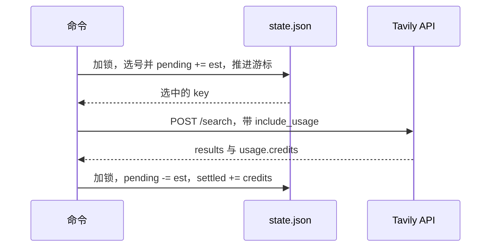
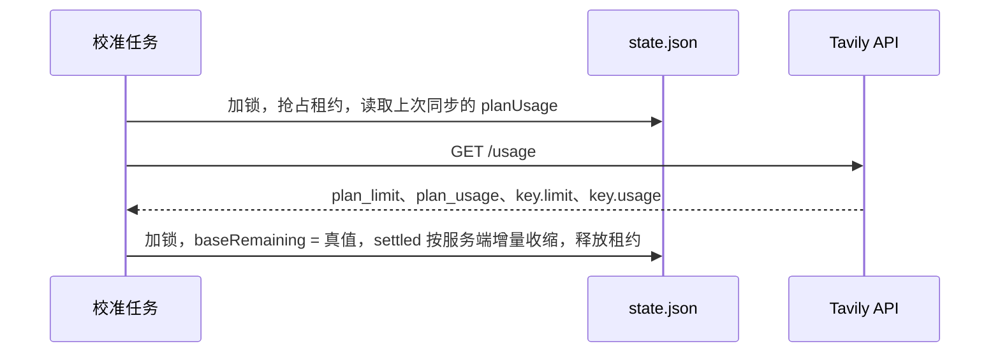

# 额度与记账

## 计费模型

| 接口 | 积分 |
|---|---|
| search basic、fast、ultra-fast | 每次 1 |
| search advanced | 每次 2 |
| extract basic | 每 5 个成功 URL 1 |
| extract advanced | 每 5 个成功 URL 2 |
| map | 每 10 个页面 1，带 `instructions` 时每 10 个页面 2 |
| crawl | map 部分与 extract 部分之和 |

免费额度每月 1000 分，按账号发放。同一账号下的多个 key 共享额度，`/usage` 的 `account` 段是账号级数据，`key` 段是单个 key 的数据。

## 预估

预估一律取上界。

| 命令 | 公式 |
|---|---|
| search | `depth == advanced ? 2 : 1` |
| extract | `ceil(urls × depthCost / 5)`，`depthCost` 为 1（basic）或 2（advanced） |
| map | `ceil(limit / 10) × (instructions ? 2 : 1)` |
| crawl | `ceil(limit / 10) × (instructions ? 2 : 1) + ceil(limit × depthCost / 5)` |

extract 只对成功抽取计费，crawl 的实际页数不超过 `limit`，上界足够保守。

## 会计字段

每个 key 在 `state.json` 里记四个会计字段，其余控制字段见 [号池与选号](pool.md)。

| 字段 | 含义 | 唯一写入者 |
|---|---|---|
| `baseRemaining` | 上次校准时服务器给出的剩余额度 | 校准 |
| `settled` | 取得 `baseRemaining` 之后已确认的积分 | 结算 |
| `pending` | 在途请求的预估预留 | 预留与结算 |
| `penalty` | 额度类失败收紧出的临时扣减 | 故障处理，校准时清零 |

```
remaining = max(0, baseRemaining - settled - pending - penalty)
```

`baseRemaining` 为 `null` 且未标记 `unlimited` 时表示从未校准成功，该号不参与轮询。

每个字段只有一类路径会写，任何路径都不需要读取并改写别人的字段。三组路径因此可以互不等待，并发时也不会互相覆盖。

## 预留与结算



预留与结算各是一次短锁事务，网络请求在锁外。

结算时从响应读 `usage.credits`：

- 为正数时 `settled += credits`。
- 为 0 或缺失时 `settled += 0`。extract、map、crawl 按批次计费，未满一批返回 0，差额由下一次校准补齐。
- 请求失败时只扣回 `pending`，`settled` 不动。

预留值始终扣回，不因失败而保留，所以失败不会污染余额估计。

## 校准

校准是唯一写 `baseRemaining` 的路径。



真值按账号级与 key 级限额取小：

```
planRemaining = plan_limit == null ? ∞ : plan_limit - plan_usage
keyRemaining  = key.limit  == null ? ∞ : key.limit  - key.usage
baseRemaining = max(0, min(planRemaining, keyRemaining))
```

两者都为 null 时把该号标记为 `unlimited`，选号时始终视为充足。

回写时按服务端用量的变化量 `Δ = 新 plan_usage - 上次 plan_usage` 收缩 `settled`：

| 情况 | 处理 |
|---|---|
| 首次同步，没有历史值 | `baseRemaining = 真值`，`settled = 0` |
| `Δ > 0` | `baseRemaining = 真值`，`settled = max(0, settled - Δ)`，`penalty = 0` |
| `Δ = 0` 且 `settled > 0` | 服务器尚未计入本地消耗，`baseRemaining = 真值`，`settled` 与 `penalty` 保持不变 |
| `Δ = 0` 且 `settled = 0` | `baseRemaining = 真值`，`penalty = 0` |
| `Δ < 0` | 视为新计费周期，`baseRemaining = 真值`，`settled = 0`，`penalty = 0` |

`Δ` 包含同一账号下其他客户端的消耗，`settled - Δ` 因此可能偏小，剩余额度偏低，方向安全。

## 触发集合

| 触发 | 时机 | 阻塞业务 | 最小间隔 |
|---|---|---|---|
| 周期校准 | 某号 `callsSinceSync >= syncEvery`（10） | 否 | 是 |
| 跳号校准 | 轮询时因余额不足跳过该号 | 否 | 是 |
| 额度类失败 | 收到 432 或 433 | 有重试预算时否，否则退出前等待 | 否 |
| 显式校准 | `usage --sync` | 是 | 默认是，`-f` 否 |
| 全部跳过 | 一轮扫描没有可用号 | 是，上限 `drainTimeoutSec` | 是 |

周期校准与跳号校准进入后台队列，命令结束时统一 drain。全部跳过路径在重试前等待本轮登记的校准。这两个等待点共用配置项 `drainTimeoutSec`（默认 5 秒）。显式校准直接等待自己的请求，不受该上限约束。最小间隔由配置项 `minSyncIntervalSec`（60）控制，按 key 计算。

额度类失败触发的校准跳过最小间隔，因为它本身就是判定余额有误的证据。

## 额度类失败

收到 432 说明本次预估高于真实剩余。把 `penalty` 提高到让剩余恰好低于本次预估：

```
penalty = max(penalty, baseRemaining - settled - pending - estimate + 1)
```

这里 `pending` 已经扣回本次预留。

效果是 advanced 被拒后该号仍可服务 basic，basic 再被拒后剩余降到 0，直到校准给出新值。式子幂等，连续失败不会叠加扣减。

433 按同样方式处理。

## 并发

- 三条路径的网络请求都在锁外，锁内只做字段读写。
- 结算与校准使用互不相交的字段，冲突退化为有界误差，下一轮校准修复。
- 同一个 key 同时只允许一个校准：锁内抢占 `syncingUntil` 租约，租约 5 秒过期，进程崩溃后自动释放。
- 进程被杀会留下 `pending`，加载时若 `pendingAt` 超过 10 分钟则清零。
- 所有后台任务进入同一个集合，退出前 `drain(drainTimeoutSec)`，失败路径同样执行。

## 记账延迟

`/usage` 的用量计数器不保证实时。实测中，连续请求消耗了积分后，`plan_usage` 数分钟内仍保持不变，而每次响应的 `usage.credits` 已正常返回。

因此校准不能简单地用真值覆盖本地台账，否则每次同步都会把尚未计入的消耗抹掉，剩余额度被高估。`Δ` 为 0 且本地 `settled` 仍为正时，保留 `settled` 与 `penalty`，等待服务器计数器追上。`Δ < 0` 是唯一可以判定计费周期翻转的信号。
