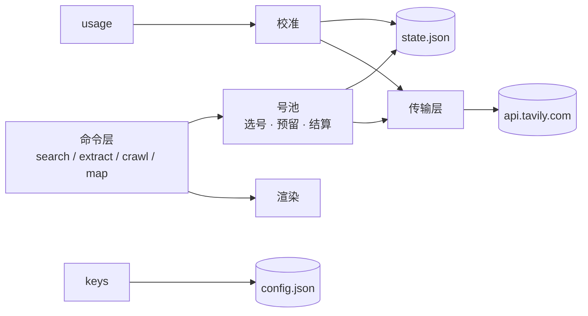

# 总览

`tavily-cli` 是给 agent 用的 Tavily 检索命令行，内置多账号额度池。命令名 `tavily-cli`，配置目录 `~/.tavily-cli`，与官方 `tvly` 互不干扰。

## 目标

| 目标 | 落地方式 |
|---|---|
| 四类检索 | `search`、`extract`、`crawl`、`map` |
| 额度自由 | 多个账号按轮询自动切换，单号耗尽不影响整体可用 |
| 额度可见 | `usage` 报告每个号的剩余与状态 |
| 面向 agent | stdout 只放数据，诊断走 stderr，退出码固定 |

## 非目标

| 项 | 说明 |
|---|---|
| 登录、登出、初始化向导 | 凭证由 `keys add` 写入 |
| research | 单次 15 到 250 分，与号池的额度预算冲突 |
| MCP 托管、REPL、终端富文本 | agent 直接调用命令 |
| keyless 模式 | 额度与限流不可控 |
| 自动更新 | 交给包管理器 |

## 与 tvly 的差异

| 维度 | `tvly` | `tavily-cli` |
|---|---|---|
| 凭证 | 单 key 或 OAuth，存于 `~/.tavily` | key 池，存于 `~/.tavily-cli` |
| 命令 | init、login、logout、auth、search、extract、crawl、map、research、setup、update | search、extract、crawl、map、usage、keys |
| 额度 | 不跟踪 | 逐次记账，周期性校准，按轮询分配 |
| 输出 | 终端渲染、管道纯文本、`--json`、`--output-dir` | 纯文本、`--json`、`-o`、`--output-dir` |
| 交互 | 交互式 shell 与确认提示 | 无交互 |

## 总体结构

| 模块 | 职责 |
|---|---|
| `commands/` | 参数解析、组织请求、渲染输出 |
| `core/pool.ts` | 选号、预留、结算、故障转移 |
| `core/sync.ts` | `/usage` 校准与状态合并 |
| `core/cost.ts` | 积分预估与响应积分提取 |
| `core/state.ts` | `state.json` 的读写、加锁、原子替换 |
| `core/config.ts` | `config.json` 的读取与校验 |
| `core/client.ts` | 传输层构造与请求封装 |
| `core/queue.ts` | 后台任务登记与退出前 drain |
| `ui/` | 流路由、文本渲染、错误报告、JSON 与逐页文件落盘 |

## 一次检索的生命周期

1. 解析参数，算出本次预估积分。
2. 在状态文件锁内选号，把预估计入该号的 `pending`，推进游标。
3. 发送请求，带上 `include_usage`。
4. 在锁内结算：扣回 `pending`，把响应里的 `usage.credits` 计入 `settled`。
5. 输出结果。
6. 若有待办的后台校准，等待其完成或超时，然后退出。

记账公式见 [额度与记账](credit.md)，选号与故障转移见 [号池与选号](pool.md)。
