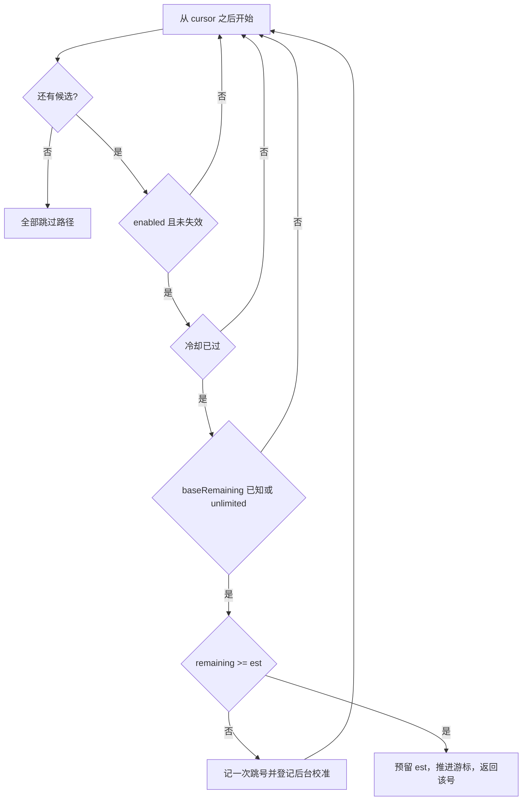

# 号池与选号

## config.json

`~/.tavily-cli/config.json`，目录 0700，文件 0600（Windows 上忽略权限位）。

```json
{
  "keys": [
    { "label": "main", "key": "tvly-dev-...", "enabled": true },
    { "label": "alt-1", "key": "tvly-dev-...", "enabled": true }
  ],
  "syncEvery": 10,
  "minSyncIntervalSec": 60,
  "drainTimeoutSec": 5,
  "retries": 1,
  "apiBaseUrl": "https://api.tavily.com"
}
```

| 字段 | 默认 | 说明 |
|---|---|---|
| `keys` | 必需 | 数组顺序就是轮询顺序，也作为优先级使用 |
| `syncEvery` | 10 | 单个号累计多少次调用后触发周期校准 |
| `minSyncIntervalSec` | 60 | 自动校准的最小间隔 |
| `drainTimeoutSec` | 5 | 等待后台校准的上限，同时约束退出前的 drain 与全部跳过后的重试 |
| `retries` | 1 | 额度类失败时最多再换几个号 |
| `apiBaseUrl` | `https://api.tavily.com` | 接口地址 |

`enabled` 缺省为真。写入统一走临时文件加 rename，全程持锁。

## state.json

`~/.tavily-cli/state.json`。key 用 `sha256(key)` 的前 16 位十六进制作为 id，避免在两处保存密钥。

```json
{
  "version": 1,
  "cursor": "alt-2",
  "keys": {
    "3f9c1a7d2b4e6f80": {
      "label": "main",
      "baseRemaining": 831,
      "unlimited": false,
      "settled": 4,
      "pending": 0,
      "pendingAt": 1795075700000,
      "penalty": 0,
      "syncedAt": 1795075627127,
      "planUsage": 169,
      "callsSinceSync": 3,
      "syncingUntil": null,
      "cooldownUntil": null,
      "invalid": null,
      "lastError": null
    }
  }
}
```

会计字段的含义与公式见 [额度与记账](credit.md)。

| 字段 | 说明 |
|---|---|
| `cursor` | 上次选中的 label，扫描从它的下一位开始 |
| `syncedAt` | 最近一次校准成功的时间 |
| `planUsage` | 上次校准时服务器返回的 `account.plan_usage`，用于识别计费周期翻转与计数延迟 |
| `callsSinceSync` | 距上次成功校准的调用次数 |
| `syncingUntil` | 校准租约的到期时间 |
| `cooldownUntil` | 429 冷却的到期时间 |
| `invalid` | `{ "reason": "...", "at": 1795075627127 }` 或 `null` |
| `lastError` | 最近一次失败的原因，仅供展示 |

加载时丢弃 label 已不在配置中的记录。文件无法解析时退出码 1，不静默重建。

## 轮询

扫描从 `cursor` 的下一位开始，按 `keys` 数组顺序循环，取第一个可用号。选中后在同一锁事务内把 `cursor` 设为该号并完成预留。



| 跳过原因 | 是否登记校准 | 说明 |
|---|---|---|
| 未启用 | 否 | 由配置控制 |
| 已失效 | 否 | 需要人工处理 |
| 冷却中 | 否 | 到期自动恢复 |
| 从未校准 | 否 | 需要执行 `usage --sync` |
| 余额不足 | 是 | 月重置后由这里自愈 |

只有"余额不足"会触发后台校准，其余跳过保持静默，避免无意义的请求。

选号与预留在同一锁事务内完成，并发进程看到的是不同的游标位置，请求自然分散到不同账号。

## 全部跳过

一轮扫描没有可用号时：

1. 等待本轮登记的后台校准，上限为 `drainTimeoutSec`（默认 5 秒）。
2. 重新扫描一次。
3. 仍然没有可用号，退出码 3，并在 stderr 列出每个号的跳过原因和当前剩余。

月初额度重置后，第一轮校准会把剩余刷新回 1000，第 2 步即可选中。余额确实耗尽时，这一步只会多一次 `/usage` 请求。若本轮校准全部因最小间隔被抑制，直接进入第 3 步，此时需要手工执行 `usage --sync -f`。

## 故障转移

| 响应 | 处理 | 是否换号 |
|---|---|---|
| 401、403 | 标记 `invalid`，记录原因 | 是 |
| 432、433 | 按 [额度与记账](credit.md) 收紧 `penalty`，登记校准 | 是 |
| 429 | 写入 60 秒冷却 | 是 |
| 434 | 直接失败，退出码 4 | 否 |
| 网络错误、超时、5xx | 直接失败，退出码 4 | 否 |

总尝试次数为 `1 + retries`，上限为 key 总数。每次换号都从游标的下一位继续，不重复使用本轮已经失败的号。网络错误与 5xx 不重试，避免服务端已经扣费时重复计费。

全部失败时退出码 3（额度与鉴权类）或 4（API 类），stderr 汇总每个号的结果。

## 额度收紧后的行为

`penalty` 会让一个还有余额的号暂时显示为低剩余。校准成功后 `penalty` 清零，剩余恢复。这是额度类失败自我修复的唯一途径，因此失败触发的校准不受最小间隔约束。

## 与其他客户端共存

同一账号同时在 `tvly`、MCP 或其他机器上使用时，本地 `settled` 会落后于服务器计数，剩余被高估。周期性校准与 432 收紧共同限制这个偏差的影响范围。跨机共享状态不在设计范围内。
